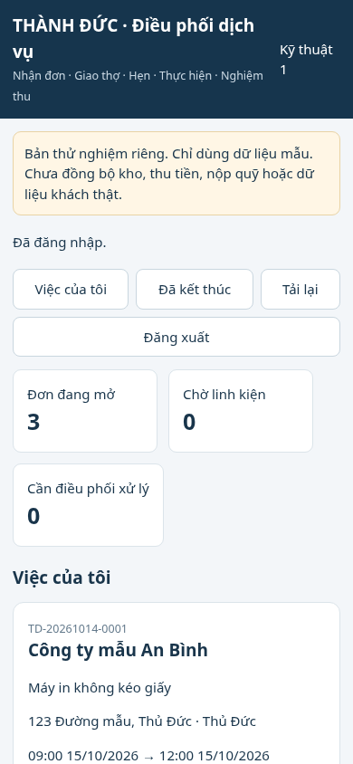
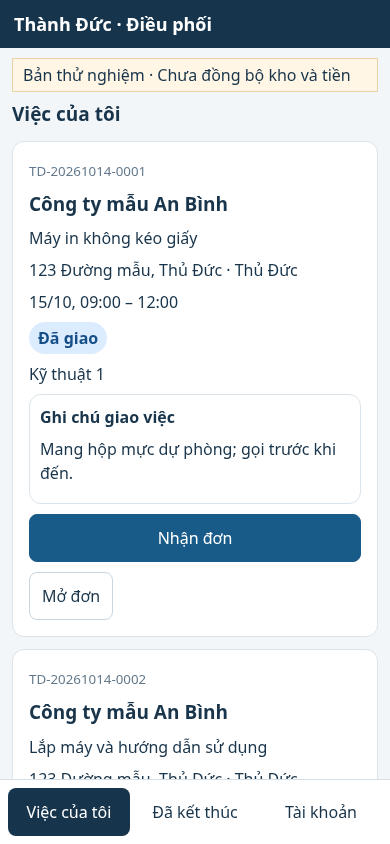
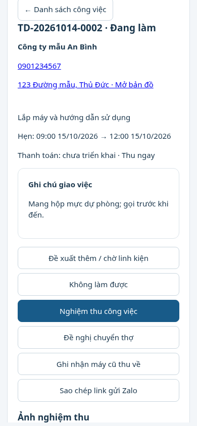
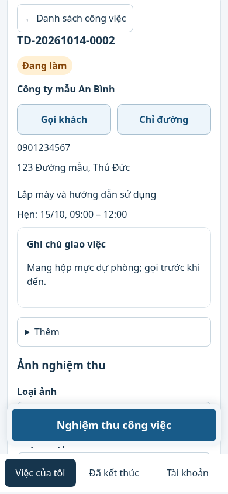
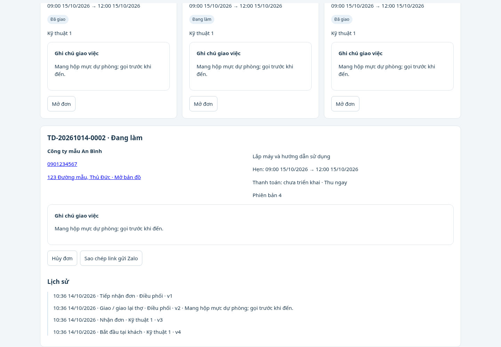
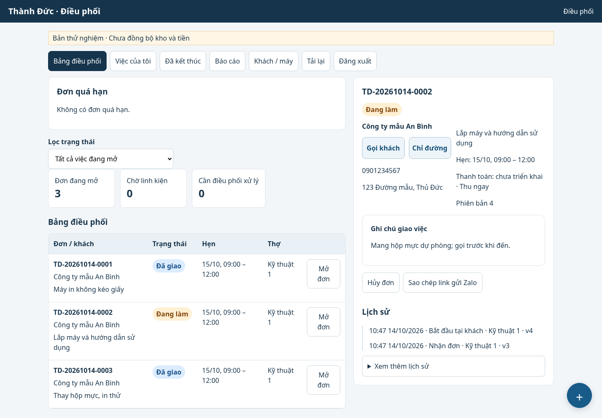

# So sánh giao diện Điều phối — 14/10/2026

Ảnh dùng cùng bộ dữ liệu mẫu riêng, không lấy dữ liệu Google thật. Ảnh trước được chụp từ commit a4b9e8f trước khi sửa giao diện; ảnh sau chụp từ mã cập nhật. Viewport điện thoại 390 × 844, máy tính 1440 × 1000. Thông báo thành công ở ảnh sau đã tự tắt.

| Màn hình | Trước | Sau |
| --- | --- | --- |
| Thợ: danh sách 390px |  |  |
| Thợ: chi tiết 390px |  |  |
| Điều phối: bảng và chi tiết |  |  |

Chụp lại ảnh của mã hiện tại: từ gốc repository chạy `node service-dispatch/test/ui-screenshots.cjs after`. Script dùng Chromium tại `/usr/bin/chromium`, khởi tạo fixture và đóng/xóa fixture sau khi chụp. Để tái hiện bản trước cần mã của commit a4b9e8f; không chạy tên `before` trên bản mới để ghi đè ảnh gốc.

Giao diện chỉ dùng dữ liệu API hiện có. Số việc hôm nay trong bộ chọn thợ tính theo ngày tiếp nhận và người phụ trách hiện tại; việc đang làm theo trạng thái working, việc mở theo open_count. Khu vực chưa cấu hình hiển thị rõ Chưa có khu vực, không tự suy đoán.
